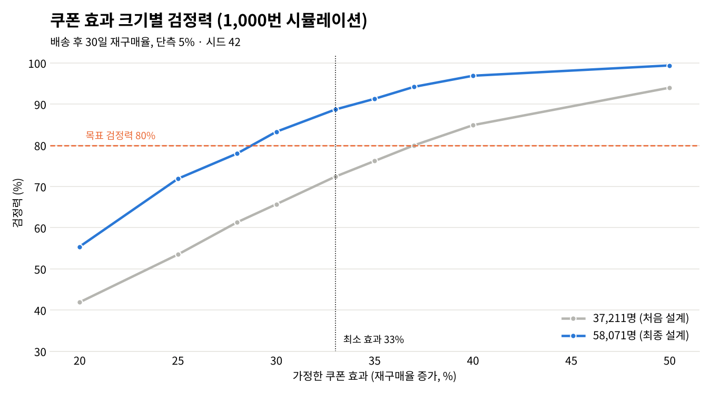
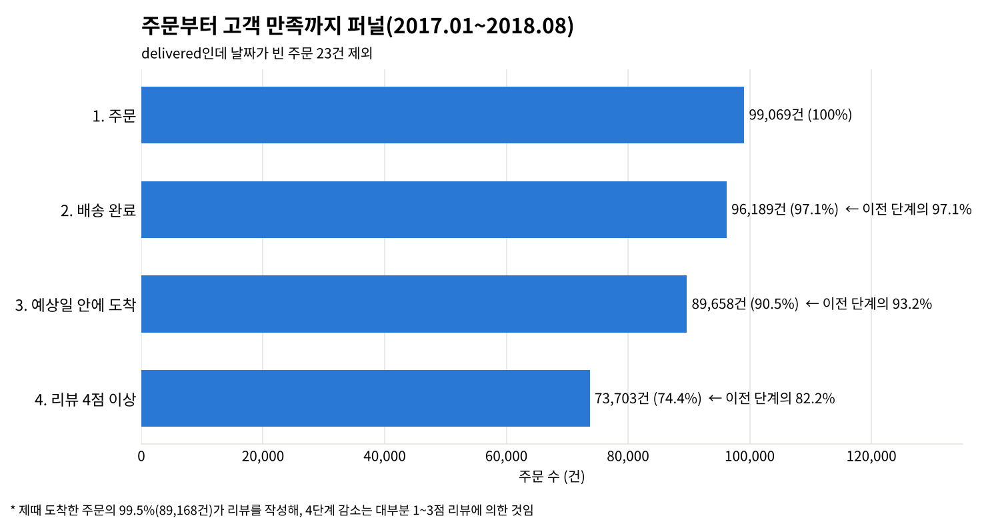

# Olist 이커머스 재구매 분석과 쿠폰 A/B 테스트 설계

브라질 이커머스 Olist의 주문 약 10만 건을 분석해 재구매가 낮은 원인을 진단한 뒤, 재구매 쿠폰의 효과를 검증할 A/B 테스트를 설계한 프로젝트다.

## 핵심 질문

> 성장이 멈춘 Olist, 얼마나 많은 고객이 재구매를 할까? 재구매는 언제 일어날까? 그리고 그 시점에 쿠폰을 주면 재구매가 늘어나는지 어떻게 검증할 수 있을까?

## 결론과 제안

1. **배송 직후 발급하는 30일 유효 쿠폰을 A/B 테스트로 검증한다.** 남동부 첫 구매 고객 58,071명 대상, 쿠폰 효과 33%를 검정력 88.7%로 검출할 수 있다.
2. **배송 지연은 예상일을 넘긴 직후 대응해야 한다.** 예상일을 1\~3일만 넘겨도 1\~2점 리뷰 비율이 3배가 되고, 지연 주문의 절반이 SP·RJ에서 발생한다. RJ는 지연율이 SP의 2.7배로 거리로 설명되지 않는다.
3. **재구매율 지표 정의를 통일한다.** 같은 날 나눠 결제한 주문을 재구매로 세면 문제 크기가 3.0%로 부풀려진다(실제 2.1%).

## 주요 발견

- 2018년 거래액 성장이 멈췄고 고객의 97%가 한 번만 산다. 같은 날 주문을 빼면 실제 재구매율은 2.1%다.
- 만족을 가른 것은 배송 속도가 아니라 예상일 준수였다. 지연 주문은 6.7%지만 1\~2점 리뷰의 32.6%를 차지했다.
- 첫 주문 배송이 길수록 덜 돌아왔고(2.19% → 1.42%), 180일 재구매의 33%가 첫 30일에 몰렸다.
- 처음 설계(37,211명)는 검정력이 72.4%로 부족했다. 주 지표(30일 재구매율)에 맞게 대상을 다시 정의해 58,071명, 검정력 88.7%로 높였다.

## 분석 과정에서 바꾼 판단

| 판단 | 초기 설정 | 최종 결정 | 근거 |
|---|---|---|---|
| 재구매율 정의 | 2회 이상 구매 고객 3.0% | 같은 날 주문 제외 2.1% | 같은 날 재주문 30.2%, 그중 89.5%가 10분 이내 |
| 실험 대상 | 180일 분석 대상 37,211명 (검정력 72.4%) | 30일 관찰 가능 고객 58,071명 (검정력 88.7%) | 주 지표가 30일 재구매율이라 180일 관찰이 필요 없음 |
| 쿠폰 유효기간 | 14일 (검정력 68.5%) | 30일 | 14일 재구매율 0.341%로 효과 검출이 어려움 |

전체 결정 기록은 [의사결정 기록](docs/decision_log.md)에 정리했다.



## 분석 흐름

| 단계 | 핵심 결과 | 문서 |
|---|---|---|
| 1. 데이터 준비 | 분석 기간·고객 ID·거래액 기준 정의, 품질 점검 | [01. 데이터 준비](docs/01_data_preparation.md) |
| 2. 탐색적 분석 | 2018년 성장 정체, 1회 구매 고객 97%, 남동부 쏠림 | [02. 탐색적 분석 (EDA)](docs/02_eda.md) |
| 3. 퍼널·배송 지연 | 예상일 지연이 불만의 핵심, 지연은 SP·RJ에 절반 | [03. 퍼널과 배송 지연](docs/03_funnel_delivery.md) |
| 4. 재구매 | 첫 주문 배송이 길수록 재구매 감소, 재구매 33%가 첫 30일 | [04. 재구매 분석](docs/04_repurchase.md) |
| 5. A/B 테스트 설계 | 대상 재정의로 58,071명, 검정력 88.7% | [05. A/B 테스트 설계](docs/05_ab_test_design.md) |

분석 기준을 정하거나 바꾼 과정은 [의사결정 기록](docs/decision_log.md)에 모았다.



## 데이터

[Brazilian E-Commerce Public Dataset by Olist (Kaggle)](https://www.kaggle.com/datasets/olistbr/brazilian-ecommerce)는 브라질 오픈마켓 연동 플랫폼 Olist의 2016\~2018년 주문 약 10만 건이다. 주문 이후 기록(결제, 배송, 리뷰)만 있고 방문·장바구니 기록은 없다.

| 테이블 | 1행의 의미 | 행 수 | 이 분석에서 쓴 정보 |
|---|---|---:|---|
| orders | 주문 1건 | 99,441 | 주문 상태, 주문·승인·출고·배송 완료·예상 도착 시각 |
| customers | 주문 1건의 고객 정보 | 99,441 | `customer_unique_id`(실제 고객), 주 |
| order_items | 주문 안의 상품 1개 | 112,650 | 상품 가격, 배송비, 판매자 |
| order_payments | 주문의 결제 1건 | 103,886 | 결제수단, 할부 개월 |
| order_reviews | 리뷰 1건 | 99,224 | 리뷰 점수 |
| products | 상품 1개 | 32,951 | 카테고리 |
| sellers | 판매자 1명 | 3,095 | 판매자 우편번호·주 |
| category_translation | 카테고리 번역 | 71 | 카테고리 영어명 |
| geolocation | 우편번호별 좌표 | 1,000,163 | 판매자–고객 거리 계산 |

분석 기준

| 항목 | 기준 | 이유 |
|---|---|---|
| 기간 | 2017.01 \~ 2018.08 | 앞뒤 구간은 월 주문이 0\~324건으로 수집이 끊김 |
| 고객 | `customer_unique_id` | `customer_id`는 주문마다 새로 생겨 모든 고객이 1회 구매로 보임 |
| 거래액 | 상품 가격 합계 (배송비 제외) | 판매 규모 기준, 결제액과 합계 차이 0.02% |
| 제외 주문 | 취소·상품 없음 (퍼널에서는 이탈로 포함) | 실제로 판매되지 않은 주문 |
| 집계 방식 | 주문 단위로 먼저 합친 뒤 JOIN | 상품·결제 행을 바로 붙이면 매출이 27% 부풀려짐 |

데이터 품질 점검과 처리 내용은 [01. 데이터 준비](docs/01_data_preparation.md)에 정리했다.

## 도구와 기법

| 항목 | 내용 |
|---|---|
| 도구 | MySQL 8, Python (pandas, statsmodels, scipy, matplotlib) |
| 기법 | 퍼널 분석, 코호트 재구매율, 카이제곱 검정, 로지스틱 회귀, 두 비율 차이 검정, 검정력 시뮬레이션 |

## 폴더 구조

```
├─ docs/                     분석 과정 문서
├─ sql/
│  ├─ 01_data_preparation/   테이블 생성·적재, 데이터 품질 점검
│  ├─ 02_eda/                월별 거래액, 주별 현황, 주 고객층, 배송비, 권역 비교
│  ├─ 03_funnel_delivery/    퍼널, 지역별 배송 지연
│  ├─ 04_repurchase/         재구매, 같은 날 재구매, 재구매 패턴
│  └─ 05_ab_test/            A/B 테스트 대상, 시드별 1회 실험
├─ python/
│  ├─ ab_simulation.py       검정력 시뮬레이션 (1,000번 반복)
│  ├─ stats_tests.py         통계 검정
│  └─ make_charts.py         그래프
├─ chart_data/               그래프에 쓴 집계 결과 (docs 그래프 + 포트폴리오 슬라이드)
├─ outputs/                  Python 입력용 데이터
└─ images/                   그래프
```

## 실행 방법

1. Kaggle에서 데이터를 받아 `sql/01_data_preparation/00_create_and_load.sql` 의 파일 경로를 바꾼 뒤 실행해 MySQL에 적재
2. `sql/` 폴더를 번호 순서대로 실행 (`04_repurchase/13_repurchase.sql` 이 만드는 테이블을 같은 폴더의 21, 23번이 사용)
3. Python 입력 데이터를 CSV로 저장 (저장해 둔 파일 포함)
   - `outputs/ab_base.csv`, `outputs/ab_base_ext.csv`: `sql/05_ab_test/` 30번, 32번 파일의 ①
   - `outputs/first_orders_for_test.csv`: `sql/04_repurchase/13_repurchase.sql` ⑩
4. 저장소 최상위 폴더에서 실행
   ```bash
   pip install pandas numpy scipy statsmodels matplotlib
   python python/ab_simulation.py   # 검정력 시뮬레이션
   python python/stats_tests.py     # p값
   python python/make_charts.py     # 그래프
   ```

## 한계와 다음 단계

| 한계 | 다음 단계 |
|---|---|
| 실험 설계까지 수행, 실행 결과는 미포함 | 실험 실행 후 주 지표·가드레일 지표를 확인해 남동부 전체 확대 여부 결정 |
| 시뮬레이션에서 추가한 재구매는 가상 주문이라 금액·리뷰 지표는 확인할 수 없음 | 실제 실험에서 재구매 주문 금액, 취소율, 1\~2점 리뷰 비율 측정 |
| 관측 데이터라 판매자·상품 등 통제하지 못한 요인이 남아, 배송 기간과 재구매를 인과로 단정할 수 없음 | RJ 장기 배송 원인 분석 (판매자 위치·상품군별) |
