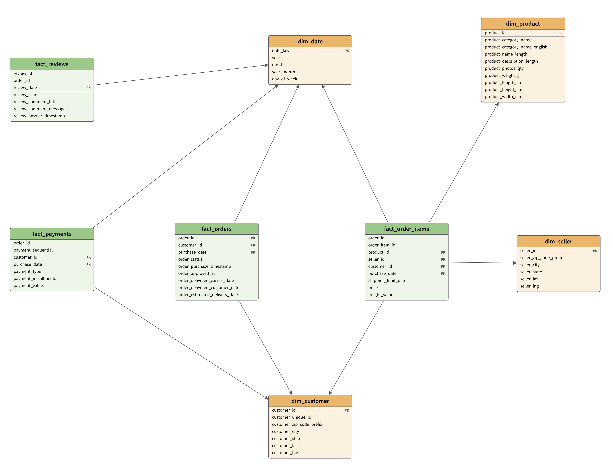

# 01. 데이터 준비

분석에 들어가기 전에 데이터가 어떻게 생겼는지, 그대로 믿어도 되는지 확인했다. 여기서 정한 기준(기간, 제외할 주문, 거래액 정의, 고객 단위)은 이후 모든 분석에 똑같이 적용했다.

## 데이터 구조

Kaggle의 [Brazilian E-Commerce Public Dataset by Olist](https://www.kaggle.com/datasets/olistbr/brazilian-ecommerce)를 사용했다. 2016\~2018년 Olist 마켓플레이스의 주문 약 10만 건이 9개 테이블로 나뉘어 있다.

| 테이블 | 1행의 의미 | 행 수 |
|---|---|---:|
| orders | 주문 1건 | 99,441 |
| customers | 주문 1건의 고객 정보 | 99,441 |
| order_items | 주문 안의 상품 1개 | 112,650 |
| order_payments | 주문의 결제 1건 | 103,886 |
| order_reviews | 리뷰 1건 | 99,224 |
| products | 상품 1개 | 32,951 |
| sellers | 판매자 1명 | 3,095 |
| category_translation | 카테고리 이름 번역 | 71 |
| geolocation | 우편번호별 좌표 | 1,000,163 |

분석 목적에 맞게 사실(fact) 테이블 4개와 차원(dimension) 테이블 4개로 나눠 스타 스키마로 정리했다.

## 분석 기간: 2017.01 \~ 2018.08

월별 주문 수를 보니 데이터 앞뒤 구간이 비어 있었다. 2016년은 9월 4건, 10월 324건, 12월 1건뿐이고 11월은 0건이었다. 2018년 9월과 10월도 16건, 4건이었고 대부분 취소 상태였다. 다른 달은 월 750\~7,500건이라 이 구간은 수집이 끊긴 것으로 보고, 20개월(2017.01\~2018.08)만 분석했다. 제외된 주문은 349건이다.

| 월 | 주문 수 | 상태 |
|---|---:|---|
| 2016-09 | 4 | canceled 2, shipped 1, delivered 1 |
| 2016-10 | 324 | delivered 265, canceled 24, invoiced 18, … |
| 2016-12 | 1 | delivered 1 |
| 2017-01 \~ 2018-08 | 월 750 \~ 7,544 | |
| 2018-09 | 16 | canceled 15, shipped 1 |
| 2018-10 | 4 | canceled 4 |

## 고객은 `customer_unique_id`로 센다

`customers` 테이블의 `customer_id`는 99,441개로 주문 수와 정확히 같았다. 주문할 때마다 새로 생기는 ID라는 뜻이다. 실제 사람을 구분하는 ID는 `customer_unique_id`(96,096개)라서, 고객 수와 재구매는 모두 이 ID로 계산했다. `customer_id`로 세면 모든 고객이 한 번만 산 것처럼 나온다.

## 취소된 주문은 거래액에서 빼고, 퍼널에서는 이탈로 본다

주문 상태는 delivered가 97.0%이고, 취소(canceled)와 상품 없음(unavailable)이 각각 0.6%였다. 이 두 상태는 실제로 판매되지 않은 주문이라 거래액과 재구매 계산에서는 뺐다. 다만 퍼널 분석에서는 바로 이 주문들이 "이탈"이라서 포함했다.

## 날짜가 비거나 순서가 뒤바뀐 주문

주문 → 결제 승인 → 출고 → 배송 완료 순서로 날짜가 찍혀야 하는데, 두 가지 문제가 있었다.

- 배송 완료 상태인데 날짜가 빈 주문 23건: 승인일 14건, 출고일 2건, 배송 완료일 8건(일부 중복)이 비어 있었다. 퍼널에서 이 주문들은 해당 단계에서 이탈한 것처럼 잘못 세어지므로 퍼널 분석에서 제외했다.
- 출고가 승인보다 빠른 주문 1,359건: 73%가 신용카드였고 평균 하루 정도 차이였다. 원인은 데이터로 알 수 없어 기록 시점 오류로 보고, 구간별 소요 시간을 계산할 때 음수가 나오는 구간만 빼고 계산했다.

그래서 퍼널은 `order_status`가 아니라 날짜가 있는지로 각 단계 통과 여부를 판단했다.

## 테이블을 그냥 붙이면 매출이 27% 부풀려진다

한 주문에 상품이 여러 개, 결제가 여러 건일 수 있다. 상품 테이블과 결제 테이블을 주문 번호로 바로 붙이면 행이 곱해진다. 실제로 그렇게 계산한 결제액 합계는 20,308,135로, 올바른 값(16,008,872)보다 27% 컸다. 그래서 여러 테이블을 붙일 때는 주문 단위로 먼저 합친 뒤 붙였다. 이후 모든 쿼리에 나오는 `order_base`(주문 1건 = 1행) CTE가 이 원칙을 적용한 것이다.

## 거래액 = 상품 가격 합계 (배송비 제외)

배송비가 상품마다 붙는지 주문마다 붙는지 헷갈려서 확인했다. 데이터셋 설명상 `freight_value`는 주문 배송비를 상품 행마다 나눠 적은 값이다. 실제로 전체 주문의 99.75%에서 "상품 가격 합 + 배송비 합 = 결제 금액"이 1헤알 이내로 맞았다(상품 1개 주문 99.74%, 2개 이상 99.78%). 그래서 주문 배송비는 주문별 `freight_value` 합계로 계산했다.

거래액은 판매 규모를 보려는 것이라 배송비를 뺀 상품 가격 합계로 정했다. 결제액과 비교하면 할부 이자, 바우처 등으로 1헤알 넘게 차이 나는 주문이 0.25%(249건) 있었지만 전체 합계 차이는 0.02%라 영향이 거의 없다.

## 그 밖에 정리한 것

| 문제 | 처리 |
|---|---|
| 리뷰가 2개 이상인 주문 547건 | 주문별 평균 점수로 1행으로 만든 뒤 사용 |
| 카테고리가 없는 상품 610개, 영어 번역이 없는 카테고리 2개 | 영어명 → 포르투갈어명 → 'unknown' 순으로 대체 |
| 우편번호 하나에 좌표가 평균 50행 | 우편번호별 평균 좌표로 1행 테이블(`zip_coord`)을 만든 뒤 거리 계산에 사용 |

## 분석용 테이블

분석마다 같은 계산을 반복하지 않도록 기준이 되는 테이블을 따로 만들었다.

| 테이블 | 1행 | 만든 이유 |
|---|---|---|
| `order_base` (CTE) | 주문 1건 | 상품 행을 주문 단위로 합쳐 행이 불어나는 것을 막음 |
| `repurchase_pair` | 2번 이상 산 고객 1명 (첫 주문 + 두 번째 주문) | 두 번째 주문까지의 간격, 같은 날 주문 여부 분석 |
| `first_orders` | 첫 구매 고객 1명 | 첫 주문의 배송 경험·금액과 180일 안 재구매 여부를 한 행에 모음 |
| `cohort180` | 첫 구매 고객 1명 (출고일까지 정상인 고객) | 배송 기간을 계산할 수 있는 고객만 남긴 180일 재구매 분석 대상 |
| `ab_base`, `ab_base_ext` | 실험 대상 고객 1명 | A/B 테스트 대상과 30일·14일 재구매 여부 |

`first_orders`를 만들 때 고객의 "첫 주문"은 분석 기간이 아니라 전체 주문 중 가장 이른 주문으로 정했다. 2016년에 이미 산 고객이 2017년 주문을 첫 주문으로 잡히면 첫 구매 고객이 아닌데 섞이기 때문이다. 같은 시각에 주문이 2건 있는 고객도 있어서, 정렬 기준에 `order_id`를 함께 넣어 실행할 때마다 같은 주문이 첫 주문으로 잡히게 했다.

코드: [`sql/01_data_preparation/`](../sql/01_data_preparation/) · 분석용 테이블은 [`13_repurchase.sql`](../sql/04_repurchase/13_repurchase.sql) ①⑤, [`30_ab_simulation_37211.sql`](../sql/05_ab_test/30_ab_simulation_37211.sql) ①
