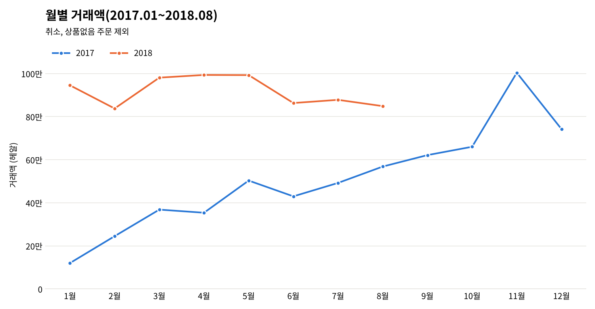
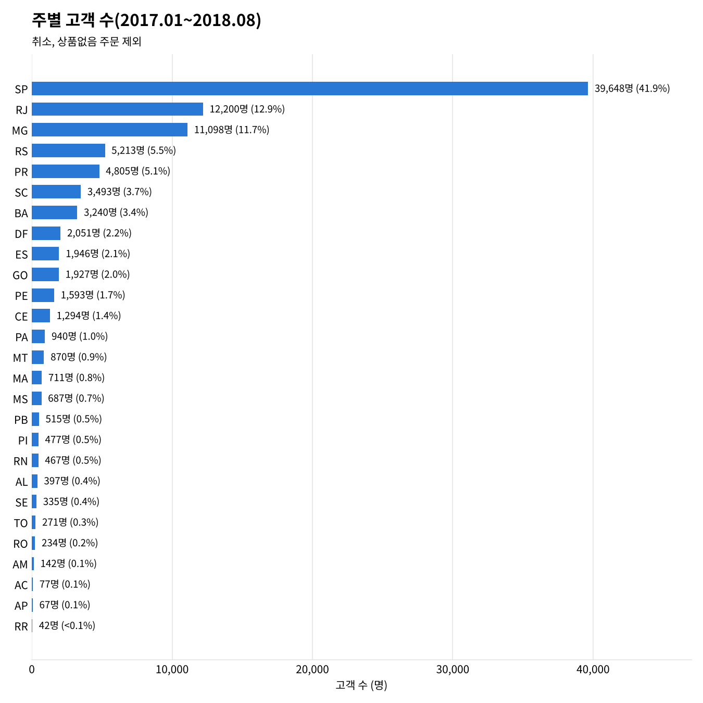
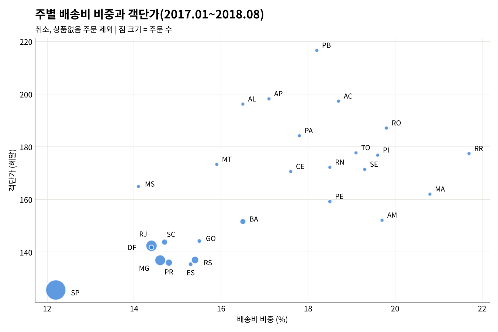
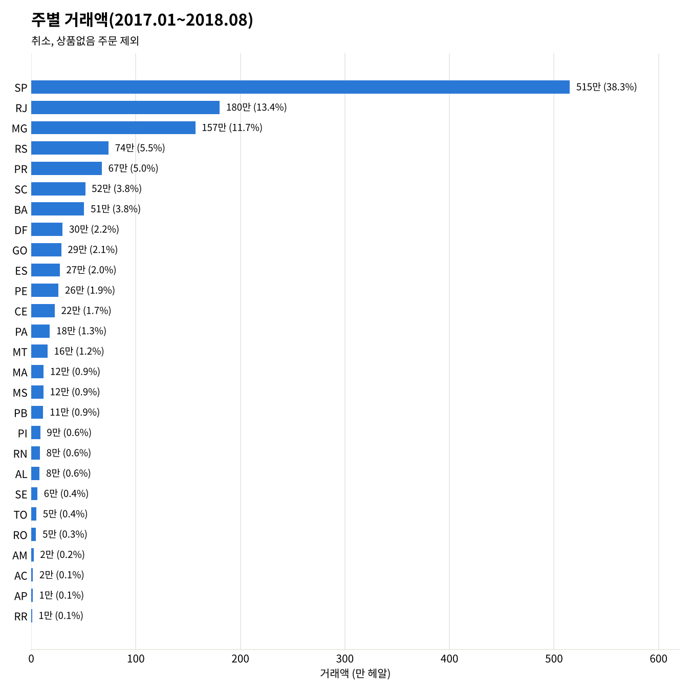
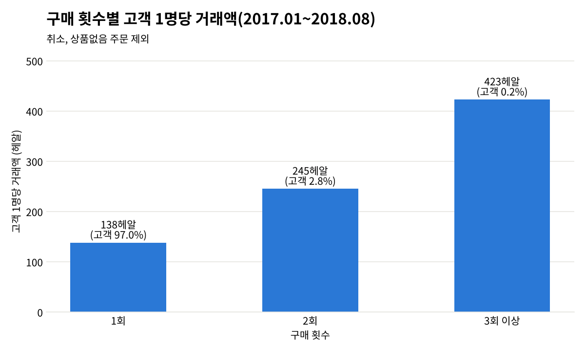
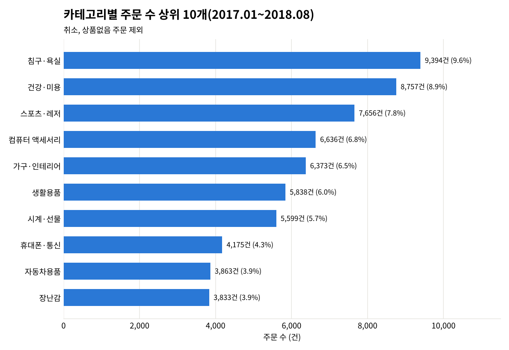
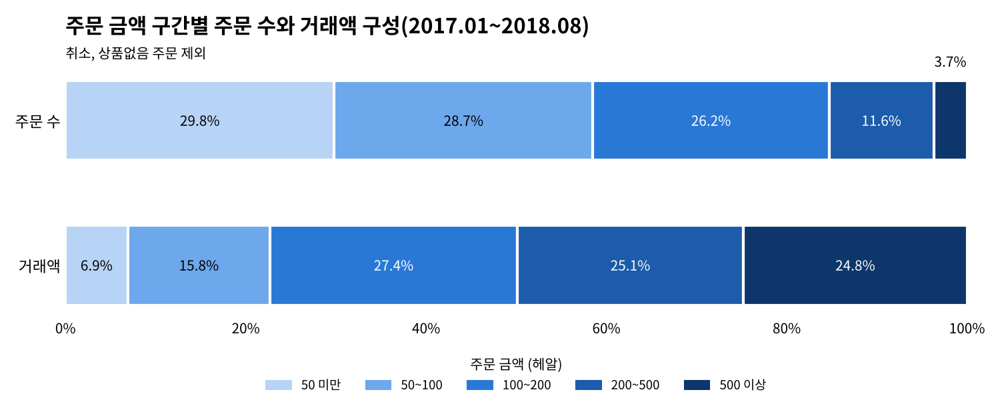

# 02. 탐색적 분석 (EDA)

본격적으로 문제를 찾기 전에 Olist의 매출이 어떻게 움직였는지, 누가 주로 사는지, 배송비는 어떻게 붙는지 먼저 살펴봤다.

## 2018년 들어 거래액 성장이 멈췄다

월별 거래액은 2017년 1월 12만 헤알에서 11월 100만 헤알까지 빠르게 늘었다. 그런데 2018년에는 월 85만\~99만 헤알 사이에 머물렀다. 3\~5월 약 99만 헤알이 가장 높았고, 6\~8월은 85만\~88만 헤알로 오히려 조금 줄었다. 2017년 11월이 유독 높은데, 이 달에 블랙프라이데이가 있었다.

월별 거래액 표 (단위: 헤알)

| 월 | 2017 | 2018 |
|---:|---:|---:|
| 1 | 120,098 | 945,456 |
| 2 | 244,959 | 837,895 |
| 3 | 368,341 | 981,051 |
| 4 | 353,843 | 993,593 |
| 5 | 503,159 | 992,872 |
| 6 | 429,917 | 863,266 |
| 7 | 492,287 | 878,044 |
| 8 | 568,246 | 848,860 |
| 9 | 621,416 | |
| 10 | 660,180 | |
| 11 | 1,003,862 | |
| 12 | 742,184 | |

성장이 멈춘 상황이라면 새 고객을 더 데려오는 것만큼, 이미 산 고객이 다시 사게 만드는 것도 중요하다. 그래서 고객이 누구이고 어떻게 사는지를 이어서 봤다.

## 고객과 거래액은 남동부에 몰려 있다

고객의 41.9%가 SP(상파울루) 한 주에 있고, SP·RJ·MG 3개 주를 합치면 고객의 66.5%, 거래액의 63.4%다. ES까지 더한 남동부 4개 주는 고객 68.5%, 거래액 65.4%다. 고객 비중과 거래액 비중이 거의 같아 고객이 많은 곳이 거래액도 많은 구조다.

주별 객단가와 배송비 비중을 함께 보면 차이가 뚜렷하다. SP는 객단가가 125.6헤알로 가장 낮고 배송비 비중도 12.2%로 가장 낮다. 반대로 북부·북동부 주들은 객단가가 160\~217헤알로 높고, 배송비가 결제 금액의 16\~22%를 차지했다. 먼 지역일수록 한 번에 많이 사지만 배송비 부담도 크다.

주별 거래액 그래프

## 주 고객은 200헤알 미만 주문을 한 번 하는 고객이다

분석 기간 동안 고객의 97%가 한 번만 구매했고, 거래액의 94%가 이들에게서 나왔다. 2번 산 고객은 2.8%, 3번 이상은 0.2%뿐이다. 1인당 거래액은 1회 고객이 138헤알, 2회 245헤알, 3회 이상 423헤알로, 다시 사는 고객의 가치는 크지만 그 수가 매우 적다.

많이 산 카테고리는 침구·욕실(주문의 9.6%), 건강·미용(8.9%), 스포츠·레저(7.8%) 순이었다. 1위도 주문의 10%가 안 되고 상위 10개를 합쳐도 63.4%라 특정 품목에 쏠리지 않았다.

주문 금액은 85%가 200헤알 미만이었다. 그런데 200헤알 이상인 주문 15%가 거래액의 절반(49.9%)을 차지했다. 주문 수로는 소액 주문이 대부분이지만 거래액은 소수의 큰 주문이 크게 좌우한다. 남동부만 보면 200헤알 미만 주문이 85.9%로 전국과 같은 구조였다.

결제는 신용카드가 75.5%로 대부분이었고, 은행이나 편의점에서 내는 브라질의 고지서 결제 방식인 boleto가 19.9%였다.

## 배송비는 주문 금액과 상관없이 붙고, 묶음 할인도 없다

배송비 구조가 구매 행동에 영향을 줄 수 있어 따로 확인했다. 주문 금액이 커져도 무료배송이 되는 기준이 없었다. 무료배송 주문은 전체의 0.3%(338건)뿐이었다. 판매자 8명이 제공했고, 338건 중 326건이 2018년 4\~5월에 몰려 있어 일시적인 판매자 프로모션으로 보인다.

| 주문 금액 | 주문 수 | 무료배송 주문 | 평균 배송비 | 상품 금액 대비 배송비 |
|---|---:|---:|---:|---:|
| 50 미만 | 29,173 | 0 | 15.4 | 48.5% |
| 50\~100 | 28,113 | 199 | 19.1 | 25.4% |
| 100\~200 | 25,689 | 128 | 24.9 | 17.4% |
| 200\~500 | 11,343 | 10 | 35.1 | 11.8% |
| 500\~1,000 | 2,660 | 1 | 50.8 | 7.4% |
| 1,000 이상 | 927 | 0 | 77.5 | 4.8% |

50헤알 미만 주문은 배송비가 상품 금액의 절반 가까이(48.5%)였다. 같은 상품을 같은 주로 보낸 주문끼리 비교해 보니, 2개를 산 주문의 배송비는 1개를 산 주문의 1.98배였다. 여러 개를 한 번에 사도 배송비가 거의 줄지 않는다는 뜻이다.

주문당 배송비는 남동부 19.9헤알에서 북부 41.4헤알까지, 먼 권역일수록 2배 가까이 비쌌다.

| 권역 | 주문당 평균 배송비 | 배송비 비중 |
|---|---:|---:|
| 남동부 (SP, RJ, MG, ES) | 19.9 | 13.2% |
| 남부 (PR, SC, RS) | 24.4 | 15.0% |
| 중서부 (DF, GO, MT, MS) | 26.5 | 15.0% |
| 북동부 (BA, PE 등 9개 주) | 35.9 | 17.9% |
| 북부 (PA, AM 등 7개 주) | 41.4 | 18.5% |

## 권역 차이는 "얼마나 자주"가 아니라 "몇 명"과 "얼마씩"에서 난다

남동부가 거래액이 많은 게 더 자주 사서인지 확인했다. 1인당 주문 수는 모든 권역에서 약 1.03회로 같았다. 남동부는 자주 사서가 아니라 고객이 많아서 거래액이 큰 것이다.

| 권역 | 고객 수 | 고객 비중 | 1인당 주문 수 | 거래액 비중 | 객단가 |
|---|---:|---:|---:|---:|---:|
| 남동부 | 64,885 | 68.5% | 1.035 | 65.4% | 131.0 |
| 남부 | 13,508 | 14.3% | 1.032 | 14.4% | 138.4 |
| 중서부 | 5,533 | 5.8% | 1.032 | 6.4% | 150.5 |
| 북동부 | 9,027 | 9.5% | 1.027 | 11.4% | 165.2 |
| 북부 | 1,773 | 1.9% | 1.031 | 2.5% | 182.0 |

북부·북동부는 지역 주문 중 200헤알 이상 큰 주문 비율이 20.7%로 남동부(14.1%)보다 높아 객단가가 높았다. 하지만 주문 수가 남동부의 6분의 1이라, 전국의 큰 주문도 63.4%가 남동부에서 나왔다. 결국 거래액은 고객 수가 많은 남동부가 결정한다.

## 정리

- 거래액 성장이 2018년에 멈췄고, 고객 대부분이 한 번만 산다. 한 번 산 고객을 다시 사게 만드는 것이 다음 성장의 열쇠라고 봤다.
- 고객이 가장 많은 남동부에서 개선 방안을 먼저 검증하는 것이 효율적이다.
- 먼 지역일수록 배송비 부담이 크고 배송도 오래 걸린다. 배송 경험이 고객 만족과 재구매에 어떤 영향을 주는지 [퍼널 분석](03_funnel_delivery.md)에서 이어서 봤다.

코드: [`sql/02_eda/`](../sql/02_eda/) (10 월별 거래액, 11 주별 현황, 12 주 고객층, 20 배송비, 22 권역 비교)
