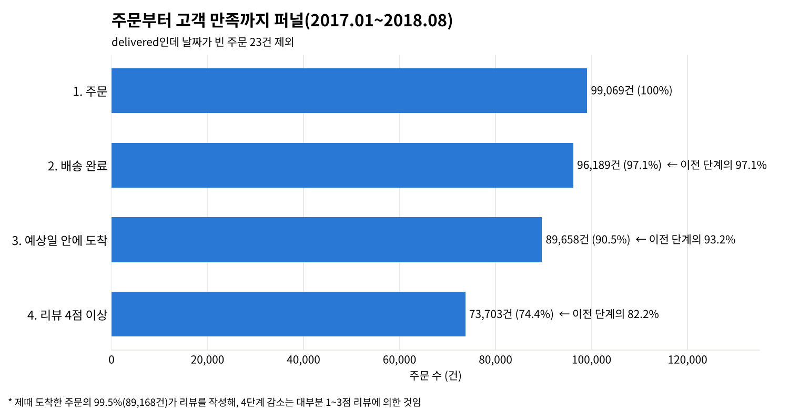
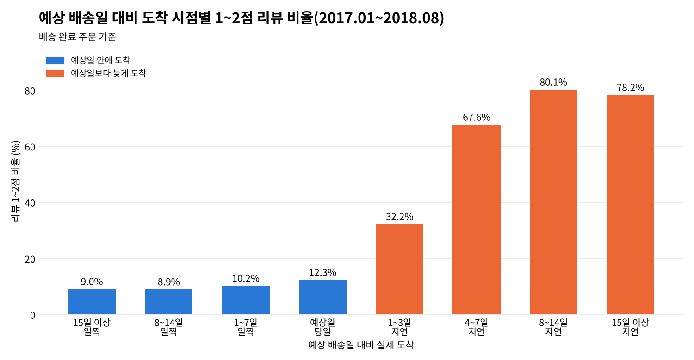
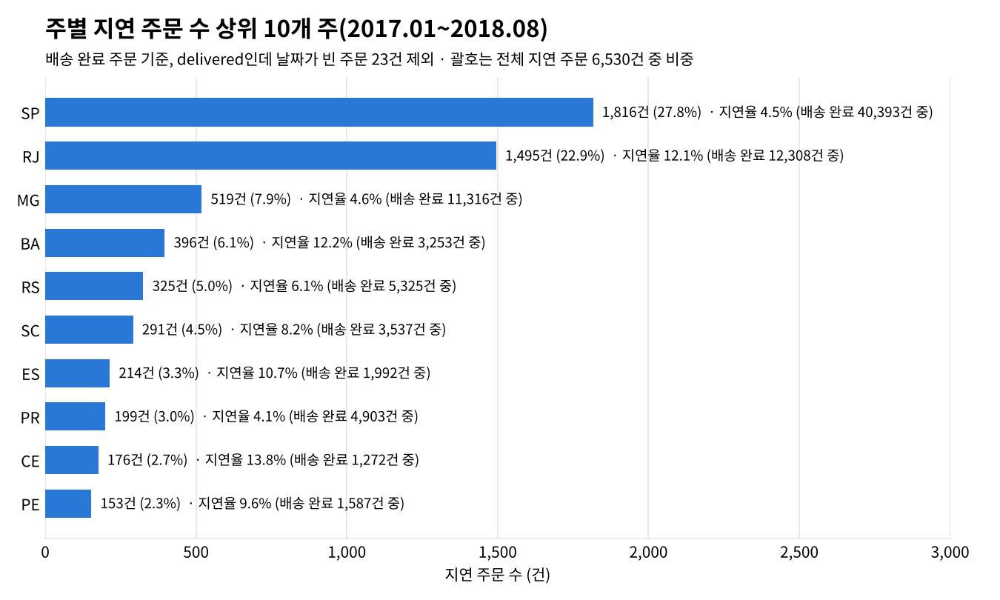

# 03. 퍼널과 배송 지연

고객이 주문한 뒤 어디에서 경험이 나빠지는지 찾기 위해 주문 이후의 단계를 퍼널로 그려 봤다.

## 주문부터 배송 완료까지는 거의 새지 않는다

주문 → 결제 승인 → 출고 → 배송 완료 순서로, 각 단계의 날짜가 있으면 그 단계를 통과한 것으로 봤다. 이 퍼널에서는 취소 주문도 이탈로 포함했다.

| 단계 | 주문 수 | 이전 단계 대비 |
|---|---:|---:|
| 주문 | 99,069 | |
| 결제 승인 | 98,948 | 99.9% |
| 출고 | 97,355 | 98.4% |
| 배송 완료 | 96,189 | 98.8% |

단계마다 빠지는 주문이 1\~2%뿐이었다. 배송 완료 전에 멈춘 2,880건을 보면 승인 후 출고 전에 멈춘 주문이 가장 많았지만(1,593건), 이 중 상당수는 아직 처리 중인 주문이었다. 이 구간은 개선할 여지가 작다고 판단했다.

멈춘 단계와 단계별 소요 시간

| 멈춘 단계 | 주문 수 | 주요 상태 |
|---|---:|---|
| 결제 승인 전 | 121 | 취소 116 |
| 승인 후 출고 전 | 1,593 | 상품 없음 602, 취소 394, 처리 중 299, 송장 발행 296 |
| 출고 후 배송 완료 전 | 1,166 | 배송 중 1,097, 취소 69 |

| 구간 (배송 완료 주문) | 평균 소요 |
|---|---:|
| 주문 → 결제 승인 | 10.2시간 |
| 결제 승인 → 출고 | 2.8일 |
| 출고 → 배송 완료 | 9.3일 |
| 전체 | 12.5일 |

## 퍼널을 배송 이후까지 늘리자 큰 감소가 보였다

고객 입장에서 주문은 배송 완료로 끝나지 않는다. 그래서 "예상일 안에 도착했는가"와 "리뷰 4점 이상을 줬는가"를 단계로 추가했다.

배송 완료 이후 두 단계에서 앞 단계보다 훨씬 크게 줄었다. 배송 완료 주문의 6.8%가 예상일보다 늦게 왔고, 제때 온 주문 중에서도 17.8%는 4점 미만이었다. 리뷰를 안 써서 줄어든 것은 아닌지 확인했는데, 제때 도착한 주문의 99.5%가 리뷰를 남겼다. 마지막 단계의 감소는 대부분 1\~3점 리뷰 때문이다.

## 지연은 적지만, 나쁜 리뷰의 3분의 1을 만든다

늦게 온 주문은 리뷰를 쓴 주문의 6.7%뿐이었다. 그런데 1\~2점 리뷰 중에서는 32.6%를 차지했다. 리뷰 4점 이상을 준 비율도 제때 온 주문은 82.7%, 늦게 온 주문은 26.7%로 3분의 1 수준이었다.

| | 리뷰 쓴 주문 비중 | 1\~2점 리뷰 수 | 1\~2점 리뷰 중 비중 | 4점 이상 비율 |
|---|---:|---:|---:|---:|
| 제때 도착 | 93.3% | 8,214 | 67.4% | 82.7% |
| 늦게 도착 | 6.7% | 3,977 | 32.6% | 26.7% |

## 빨리 오는 것보다 예상일을 지키는 것이 중요하다

배송이 빠를수록 만족도가 올라갈 것이라고 예상했다. 그래서 예상일보다 며칠 일찍 혹은 늦게 왔는지로 나눠 1\~2점 비율을 봤다.

예상과 달랐다. 예상일보다 15일 이상 일찍 오든 1\~7일 일찍 오든 1\~2점 비율은 9\~10%로 거의 같았다. 반면 예상일을 1\~3일만 넘겨도 32%로 3배가 됐고, 4\~7일 늦으면 68%, 8일 넘게 늦으면 80% 근처에서 더 오르지 않았다. 고객은 빨리 받는 것보다 약속한 날에 받는 것에 반응했다. 불만이 지연 후 첫 일주일 안에 거의 다 생기므로, 지연에 대응한다면 이 기간 안에 해야 한다.

Olist는 예상 도착일을 평균 24.3일로 안내했고, 실제 배송은 평균 12.5일이 걸렸다. 리뷰가 있는 주문의 92%가 예상일보다 일찍 도착했다. 이렇게 여유를 두고 안내했는데도 늦는 주문이 있고, 그 고객들의 불만이 컸다.

지역 때문에 생긴 착시가 아닌지도 확인했다. 주문이 많은 상위 8개 주 모두에서 지연 주문의 1\~2점 비율(52\~73%)이 제때 온 주문(9\~11%)보다 크게 높았다. 지역과 관계없이 지연은 불만으로 이어졌다.

주별 지연 비율과 1\~2점 비율

| 주 | 리뷰 있는 주문 | 지연 비율 | 제때 도착 1\~2점 | 늦게 도착 1\~2점 |
|---|---:|---:|---:|---:|
| SP | 40,165 | 4.4% | 8.6% | 54.3% |
| RJ | 12,170 | 12.0% | 10.9% | 73.0% |
| MG | 11,248 | 4.5% | 9.4% | 58.8% |
| RS | 5,307 | 6.0% | 8.5% | 64.2% |
| PR | 4,880 | 4.0% | 9.1% | 52.1% |
| SC | 3,510 | 8.1% | 8.9% | 59.9% |
| BA | 3,226 | 11.9% | 11.2% | 60.2% |
| DF | 2,064 | 5.7% | 9.4% | 72.0% |

## 지연은 어디서 나는가: SP와 RJ에 절반

지연이 불만의 핵심이라면 어디서 많이 생기는지 알아야 대응할 수 있다. 전체 지연 주문 6,530건 중 50.7%가 SP(27.8%)와 RJ(22.9%)에서 발생했다.

SP는 지연율이 4.5%로 낮지만 주문이 워낙 많아 지연 건수가 가장 많았다. RJ는 주문 수가 SP의 3분의 1인데 지연율이 12.1%로 SP의 2.7배였고, 지연 때문에 받은 1\~2점 리뷰도 1,063건으로 SP(968건)보다 많았다.

## RJ의 지연은 거리로 설명되지 않는다

처음에는 RJ가 멀어서 늦는다고 생각했다. 판매 상품의 71%가 SP 판매자에게서 나가 대부분의 주문이 SP에서 전국으로 배송되기 때문이다. 그래서 판매자와 고객의 우편번호 좌표로 직선 거리를 계산해 비교했다.

| 주 | 평균 거리 | 안내 배송 | 실제 배송 | 여유 | 실제 배송 표준편차 | 20일 초과 | 지연율 |
|---|---:|---:|---:|---:|---:|---:|---:|
| SP | 249km | 19.7일 | 8.7일 | 11.0일 | 6.7일 | 4.5% | 4.5% |
| PR | 488km | 25.1일 | 11.9일 | 13.2일 | 7.0일 | 9.2% | 4.1% |
| RJ | 490km | 26.9일 | 15.2일 | 11.7일 | 11.5일 | 20.3% | 12.1% |
| MG | 533km | 25.1일 | 11.9일 | 13.2일 | 7.2일 | 9.4% | 4.6% |

비교할 주는 주문 1,000건 이상인 주 중에서 판매자 평균 거리가 RJ(490km)와 ±50km 이내인 PR·MG로 정했고, 최대 시장인 SP를 기준점으로 함께 봤다. RJ, PR, MG는 판매자와의 거리가 약 500km로 비슷한데 RJ만 지연율이 3배였다. 예상일을 짧게 잡아서 그런 것도 아니었다. 안내일까지의 평균 여유(11.7일)는 SP와 비슷했다. 차이는 분포에 있었다. RJ는 20일 넘게 걸리는 주문이 20.3%로 PR·MG의 2배였고, 배송 기간의 표준편차도 11.5일로 컸다. 평균은 비슷해도 유난히 오래 걸리는 주문이 많아 예상일을 넘기는 경우가 잦았다.

반대로 먼 지역이 꼭 지연이 많은 것도 아니었다. AM·AP·AC 같은 북부 원거리 주는 실제 배송이 21\~27일로 길지만, 예상일을 42\~47일로 넉넉하게 안내해 지연율이 3% 수준이었다.

## 정리

- 고객 경험이 나빠지는 곳은 배송 이후, 특히 예상일을 넘긴 순간이다.
- 지연은 SP·RJ에 몰려 있고, RJ는 거리보다 배송 기간의 들쭉날쭉함이 문제다.
- 배송 경험이 리뷰를 넘어 다시 사는 것에도 영향을 주는지 [재구매 분석](04_repurchase.md)에서 확인했다.

코드: [`sql/03_funnel_delivery/`](../sql/03_funnel_delivery/) (14 퍼널, 15 지역별 지연)
