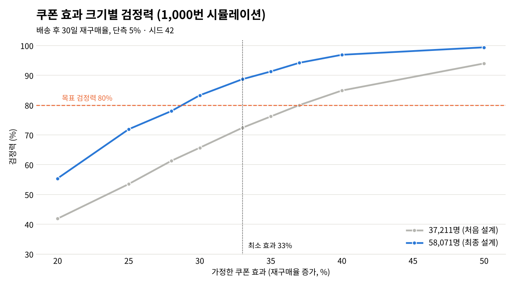

# 05. A/B 테스트 설계

재구매 분석에서 고객이 다시 사는 시점이 첫 30일에 몰린다는 것을 확인했다. 그래서 배송이 끝나자마자 재구매 쿠폰을 주면, 30일 안에 다시 사는 고객이 늘어날 것이라는 가설을 세우고, 이를 검증할 A/B 테스트를 설계했다. 실제 실험은 할 수 없으므로, 과거 데이터로 실험을 흉내 내 이 설계가 효과를 잡아낼 수 있는지(검정력)를 확인했다.

## 실험 설계

| 항목 | 내용 |
|---|---|
| 가설 | 배송 직후 쿠폰을 주면 30일 재구매율이 높아진다 |
| 귀무가설 H₀ | B 재구매율 = A 재구매율 (쿠폰 효과 없음) |
| 대립가설 H₁ | B 재구매율 > A 재구매율 |
| 지역 | 남동부 (고객이 가장 많아 먼저 검증하기 좋음) |
| 쿠폰 | 첫 주문 배송 완료 직후 발급, 유효기간 30일 |
| 주 지표 | 첫 주문 배송 완료 후 30일 안에 처음 재구매했는지 (첫 주문과 같은 날 주문 제외) |
| 그룹 | 대상 고객을 무작위로 반씩 A(쿠폰 없음) / B(쿠폰 제공) |
| 검정 | 두 비율 차이 검정, 단측, 유의수준 5% |
| 목표 검정력 | 80% 이상 |
| 최소 효과 | 33% (재구매율이 기준보다 1.33배) |

최소 효과는 "이 정도는 올라야 쿠폰을 줄 가치가 있다"고 정한 기준이다. 효과가 33% 이상이면 80% 확률로 잡아낼 수 있게 설계하는 것이 목표였다.

## 처음 설계: 37,211명으로는 부족했다

처음에는 재구매 분석과 같은 대상을 썼다. 첫 주문이 2017.01\~2018.02이고 배송이 완료된 남동부 첫 구매 고객 37,211명이다. 이 중 배송 후 30일 안에 다시 산 고객은 216명으로, 기준 재구매율은 0.580%였다.

### 실험을 흉내 내는 방법

1. 37,211명을 무작위로 A 18,606명, B 18,605명으로 나눈다.
2. B에서 재구매하지 않은 고객을 일정 확률로 "쿠폰 덕분에 재구매"로 바꾼다. 재구매율을 0.580% → 0.771%로 0.19%p 올려야 하는데, 바꿀 수 있는 고객은 B의 비재구매 고객(99.42%)이므로 바꿀 확률은 0.19% ÷ 99.42% = 0.00193이다. 평균 약 36명이 바뀐다.
3. B의 재구매율이 A보다 유의하게 높은지 단측 검정한다 (z > 1.645).

먼저 SQL로 시드를 바꿔 가며 10번 돌려 봤다.

| 회차 | 시드 (배정 / 주입) | A 재구매 | B 재구매 (주입 전 → 후) | B ÷ A | z | 결과 |
|---:|---|---:|---|---:|---:|---|
| 1 | 42 / 7 | 101 | 115 → 145 | 1.44 | 2.82 | 유의 |
| 2 | 1 / 2 | 110 | 106 → 139 | 1.26 | 1.84 | 유의 |
| 3 | 3 / 4 | 109 | 107 → 146 | 1.34 | 2.33 | 유의 |
| 4 | 5 / 6 | 100 | 116 → 144 | 1.44 | 2.83 | 유의 |
| 5 | 8 / 9 | 120 | 96 → 132 | 1.10 | 0.76 | 유의하지 않음 |
| 6 | 10 / 11 | 110 | 106 → 153 | 1.39 | 2.66 | 유의 |
| 7 | 12 / 13 | 87 | 129 → 168 | 1.93 | 5.09 | 유의 |
| 8 | 14 / 15 | 118 | 98 → 132 | 1.12 | 0.89 | 유의하지 않음 |
| 9 | 16 / 17 | 101 | 115 → 151 | 1.50 | 3.16 | 유의 |
| 10 | 18 / 19 | 109 | 107 → 143 | 1.31 | 2.15 | 유의 |

*MySQL의 `RAND(시드)`는 실행 환경에 따라 결과가 달라질 수 있어, 다시 돌리면 숫자가 다를 수 있다.*

같은 효과를 넣었는데도 10번 중 2번은 유의하지 않았다. 원래 재구매 고객 216명이 A와 B에 우연히 어떻게 나뉘느냐에 따라 결과가 크게 흔들렸다. 7회차는 재구매 고객이 B에 몰려(A 87명, B 129명) 효과가 1.93배로 부풀었고, 5·8회차는 A에 몰려 효과가 묻혔다. 한 번의 결과로는 판단할 수 없어 Python으로 1,000번 반복했다.

### 배정도 매번 새로 해야 한다

처음에는 A/B 배정을 한 번 고정하고 쿠폰 효과 주입만 1,000번 반복하는 방법도 생각했다. 그런데 이렇게 하면 "그 배정 하나에서의 검정력"만 나오고, 어떤 배정을 고정하느냐에 따라 1%에서 100%까지 달라졌다. 실험 전에는 어떻게 나뉠지 모르므로, 알고 싶은 것은 어떻게 나뉘든 평균적으로 효과를 잡아낼 확률이다. 그래서 매 반복마다 배정과 주입을 모두 새로 무작위로 했다.

### 1,000번 반복 결과

| | 효과를 넣지 않음 | 33% 효과를 넣음 |
|---|---:|---:|
| A 재구매율 평균 | 0.580% | 0.580% |
| B 재구매율 평균 | 0.581% | 0.773% |
| B ÷ A | 1.00배 | 1.33배 |
| 유의하게 나온 횟수 | 54 / 1,000 | 724 / 1,000 |
| 의미 | 1종 오류율 5.4% | 검정력 72.4% |

효과가 없을 때 유의하게 나온 비율이 약 5%라 검정은 정상적으로 작동했다. 하지만 33% 효과를 넣어도 1,000번 중 276번은 잡아내지 못해 검정력이 목표(80%)에 못 미쳤다. 효과 크기를 바꿔 가며 돌려 보니, 이 인원으로 80%를 넘기려면 최소 효과가 37% 이상이어야 했다.

## 최종 설계: 대상을 다시 정의해 58,071명으로

검정력을 높이는 방법은 두 가지였다. 최소 효과를 37%로 올리면 고객 수는 그대로지만 효과가 33\~37%인 쿠폰은 놓치게 된다. 다른 방법은 대상을 늘리는 것이다.

다시 보니 37,211명은 180일 재구매 분석을 위해 첫 주문을 2018.02까지로 제한한 숫자였다. 이번 실험의 주 지표는 배송 후 30일 재구매율이라 30일만 관찰하면 된다. 그래서 대상을 "배송 완료일 + 30일이 데이터 끝(2018.08.31) 이전인 고객"으로 다시 정의했고, 남동부 첫 구매 고객이 58,071명으로 늘었다.

| | 처음 설계 | 최종 설계 |
|---|---:|---:|
| 대상 | 첫 주문 2017.01\~2018.02 | 첫 주문 2017.01\~, 배송 후 30일 관찰 가능 |
| 대상 고객 | 37,211명 | 58,071명 |
| 30일 재구매 | 216명 (0.580%) | 344명 (0.592%) |
| A / B | 18,606 / 18,605 | 29,036 / 29,035 |
| 바꿀 확률 | 0.00193 | 0.00197 |
| 효과 없을 때 유의 비율 | 5.4% | 4.5% |
| 33% 효과일 때 검정력 | 72.4% | 88.7% |
| 검정력 80%에 필요한 최소 효과 | 약 37% | 약 29\~30% |

기준 재구매율은 거의 같지만 고객이 약 1.6배 늘어 배정 운에 따른 흔들림이 줄었고, 최소 효과 33%를 유지하면서 검정력 80%를 넘길 수 있었다.

효과 크기별 검정력 표 (시드 42, 1,000번)

| 최소 효과 | 20% | 25% | 28% | 30% | 33% | 35% | 37% | 40% | 50% |
|---|---:|---:|---:|---:|---:|---:|---:|---:|---:|
| 37,211명 | 41.9% | 53.5% | 61.3% | 65.7% | 72.4% | 76.2% | 80.0% | 84.9% | 94.0% |
| 58,071명 | 55.4% | 71.9% | 78.0% | 83.3% | 88.7% | 91.3% | 94.2% | 96.9% | 99.4% |

1,000번 반복이라 값은 ±3%p 정도 흔들린다. 시드를 바꾸면 28%에서 78\~80% 사이로 나와, 80%를 넘기는 경계는 28\~30%로 봤다.

## 쿠폰 유효기간은 30일

유효기간을 14일로 하면 지표도 14일 재구매율이 된다. 같은 방법으로 비교해 보니, 14일 안에 다시 사는 고객이 훨씬 적어 같은 효과를 잡아내기 어려웠다. 대상을 넓혀도 14일은 검정력이 80%에 못 미쳤다.

| 유효기간 | 37,211명 기준 재구매율 | 검정력 | 58,071명 기준 재구매율 | 검정력 |
|---|---:|---:|---:|---:|
| 14일 | 0.339% (126명) | 53.9% | 0.341% (198명) | 68.5% |
| 30일 | 0.580% (216명) | 72.4% | 0.592% (344명) | 88.7% |

## 실험하면 볼 지표

| 구분 | 지표 | 확인하는 것 |
|---|---|---|
| 주 지표 | 배송 완료 후 30일 재구매율 | 쿠폰이 재구매를 늘렸나 |
| 보조 지표 | 쿠폰 사용률 | 고객이 쿠폰을 실제로 썼나 |
| | 재구매 주문 금액 | 쿠폰 조건이 주문 금액에 영향을 줬나 |
| | 60·90일 재구매율 | 원래 나중에 살 고객을 앞당기기만 한 건 아닌가 |
| | 추가 재구매 1건당 쿠폰 비용 | 비용 대비 효과가 있나 |
| 가드레일 | 할인 후 순거래액 | 할인 때문에 수익이 줄지 않았나 |
| | 재구매 주문 취소율 | 쿠폰으로 산 뒤 취소가 늘지 않았나 |
| | 재구매 주문 1\~2점 리뷰 비율 | 만족도가 떨어지지 않았나 |

결과를 보기 전에는 A와 B가 실제로 반씩 나뉘었는지(SRM), 한 고객이 두 그룹에 들어가지 않았는지, 쿠폰이 B에 제대로 발급됐는지를 먼저 확인한다. 검정은 실험이 끝난 뒤 한 번만 한다. 중간에 여러 번 결과를 보고 멈추면 우연히 유의하게 나올 확률이 커진다.

결과가 유의하더라도 바로 확대하지는 않는다. 가드레일 지표에 문제가 없고, 보조 지표에서 원래 살 고객을 앞당기기만 한 것이 아닌지와 추가 재구매 1건당 쿠폰 비용을 확인한 뒤 B 방식을 남동부 전체로 넓힌다. 유의하지 않다면 효과가 없다는 증명이 아니라 33%보다 작은 효과라 잡지 못했을 수 있다.

## 한계

- 시뮬레이션에서 추가한 재구매는 가상의 주문이라 금액·리뷰 관련 지표는 실제 실험에서만 확인할 수 있다.
- 과거 데이터로 만든 기준 재구매율이 실험 시점에도 비슷하다고 가정했다.
- 쿠폰 사용·할인 데이터가 없어 할인액은 정하지 않았다. 할인액에 따라 실제 쿠폰 효과는 달라질 수 있다.

코드: [`sql/05_ab_test/`](../sql/05_ab_test/) (대상 고객 테이블, 시드별 1회 실험), [`python/ab_simulation.py`](../python/ab_simulation.py) (1,000번 반복, 효과 크기별 검정력)
